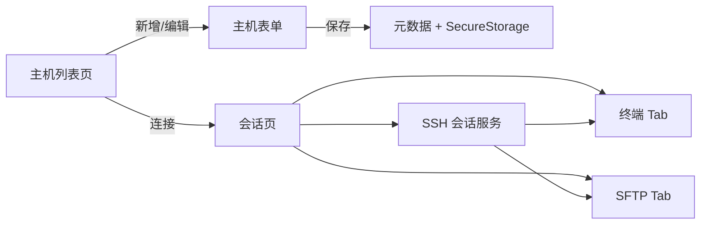

# Flutter SSH 工具（Windows 首版）

## 目标范围

- **平台**：先交付 Windows Desktop；工程启用 `windows`，并保留 `macos` / `android` / `ios` 平台目录以便后续复用。
- **认证**：仅密码登录；主机、端口、用户名明文落库，密码用系统安全存储。
- **会话 UI**：主机列表 → 连接一台 → 会话页内 **终端 / SFTP** 两个 Tab；不做多连接页签、不做左右分栏。
- **不做**（首版）：私钥、SSH Agent、端口转发、多会话、本地终端。

## 技术选型

| 能力 | 包 |
|------|-----|
| SSH / SFTP | [`dartssh2`](https://pub.dev/packages/dartssh2) |
| 终端 UI | [`xterm`](https://pub.dev/packages/xterm) |
| 密码安全存储 | [`flutter_secure_storage`](https://pub.dev/packages/flutter_secure_storage) |
| 主机元数据 | [`shared_preferences`](https://pub.dev/packages/shared_preferences) 或轻量 JSON 文件（`path_provider`） |
| 状态管理 | `provider`（简单、够用） |
| 路由 | 朴素 `Navigator` 即可 |

## 信息架构



## 目录结构（新建工程后）

```
lib/
  main.dart
  app.dart
  models/host_profile.dart          # id, name, host, port, username
  services/
    credential_store.dart           # 读写密码（flutter_secure_storage）
    host_repository.dart            # 主机列表持久化
    ssh_session.dart                # 连接/断开、shell、sftp 生命周期
  providers/app_providers.dart
  screens/
    host_list_screen.dart
    host_edit_screen.dart
    session_screen.dart             # TabBar: 终端 | SFTP
  widgets/
    terminal_view.dart              # xterm + PTY 桥接
    sftp_browser.dart               # 列表、导航、上传下载、删改
```

## 核心实现要点

### 1. 工程脚手架
- `flutter create --platforms=windows,macos,android,ios ssh_flutter`（在当前空目录创建或初始化）。
- `pubspec.yaml` 加入上述依赖；Windows 确认启用桌面支持。

### 2. 凭据与主机记忆
- `HostProfile`：`id`（UUID）、显示名、`host`、`port`（默认 22）、`username`。
- 列表 JSON 存本地；密码 key 为 `ssh_pwd_<id>`，写入 `FlutterSecureStorage`。
- 表单：新建/编辑/删除主机；删除时同步清除安全存储中的密码。
- 连接前可选「是否记住密码」勾选（默认勾选）。

### 3. SSH 会话服务（`SshSession`）
- `SSHSocket.connect` → `SSHClient`（password 认证）。
- 成功后：`shell(pty: SSHPtyConfig(...))` 供终端；`client.sftp()` 供文件管理。
- 统一 `connect` / `disconnect`；断开时关闭 shell、sftp、client。
- 错误（认证失败、超时、网络）用 SnackBar / 对话框提示并回到列表或停留在会话页可重连。

### 4. 终端 Tab
- `xterm.Terminal` + `TerminalView`。
- 桥接：远程 stdout → `terminal.write`；键盘输入 → `shell.write`；窗口尺寸变化 → `shell.resize`。
- 深色终端背景，等宽字体；首版不做主题切换。

### 5. SFTP Tab
- 目录列表（名称、类型、大小、修改时间）；进入目录 / 返回上级。
- 操作：上传（系统文件选择器）、下载到本机目录、删除、新建文件夹、重命名。
- 传输进度用简单线性进度条即可；大文件流式读写避免整文件进内存。

### 6. Windows 首版验收标准
- 可添加主机并记住密码，重启应用后仍可一键连接。
- 终端可交互执行命令（如 `ls`、`pwd`）。
- SFTP 可浏览、上传、下载、删除、新建文件夹。
- 断开连接后资源释放，无崩溃。

## 后续平台（不在本版实现，仅预留）
- Mac：同一 Dart 代码；注意 `flutter_secure_storage` macOS 钥匙串权限。
- Android / iOS：同一代码；移动端键盘与文件选择器适配留到对应版本。

## 风险与默认决策
- **纯 Dart SSH**：`dartssh2` 无需原生插件即可在 Windows 跑通，利于跨平台。
- **单连接**：全局一个 `SshSession` Provider，避免并发连接复杂度。
- **UI 语言**：简体中文界面文案。
